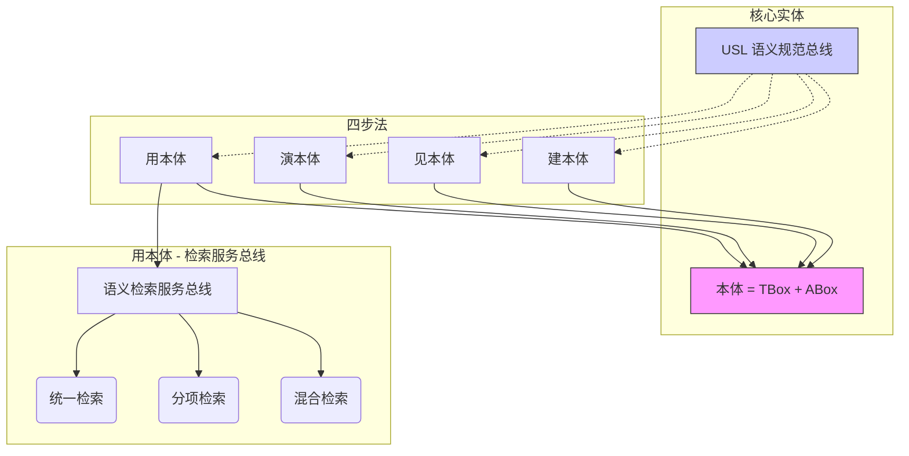

# Domain Context (统一语言表)

> 本文档定义 ODAP 项目的核心领域术语。新增或修改术语前，必须经过讨论。

## 核心术语表

| Canonical Term | 定义 | 同义词 / 易混淆词 | 备注 |
|---|---|---|---|
| **本体 (Ontology)** | TBox（结构 Schema）+ ABox（实例数据）的组合体。是 ODAP 的核心业务载体。 | 语义模型、知识图谱（狭义上指 ABox） | **不** 包含 USL 语义层。 |
| **USL (Unified Semantic Layer)** | 独立于本体的“语义规范总线”，跨域提供术语管理、概念抽取、审批流、AI 建模输入等能力。 | 统一语义层 | 横向能力，贯穿建/见/演/用四步。 |
| **TBox (Terminology Box)** | 本体的结构定义层，包含 ObjectType、RelationType、Property、ActionType 等 Schema 元素。 | 结构层、Schema 层 | 存储于 SQLite (`odap_main.db`)。 |
| **ABox (Assertion Box)** | 本体的实例数据层，包含具体的实体节点、关系连接、属性值。 | 实例层、数据层 | 存储于 Neo4j（带 `Instance` 标签）。 |
| **建本体 (Ontology Construction)** | 通过 Ontology Designer 手动建模 + Hyper-Extract (HE) AI 智能辅助建模，构建 TBox/ABox 的过程。 | 建模、构建 | 对应 User Story 1/2。 |
| **见本体 (Ontology Exploration)** | 以图形化方式探查和浏览本体内容，面向开发者（编辑态）和业务人员（探查态）提供不同权限视图。 | 图谱探查、可视化 | 编辑态与探查态强制分离；候选态默认对业务人员不可见。 |
| **演本体 (Ontology Simulation)** | 基于本体模型（TBox 规则 + ABox 数据）进行沙盘推演，预测不同策略的可能结果。包含微观规则推演（Deduction）和宏观孪生推演（Decision）。 | 仿真、推演、沙盘 | 推演数据双时态隔离（带 `scenario_id` + `valid=false`），默认对查询服务不可见。 |
| **用本体 (Ontology Consumption)** | 将本体能力通过 RESTful API / MCP Server / SDK 形式开放给下游智能体和业务系统调用。 | 服务化、API 开放 | 对外暴露 Facade 门面 `OntologyGateway` 和统一的 `SemanticRetrievalService`。 |
| **语义检索服务总线 (Semantic Retrieval Service Bus)** | 用本体阶段的核心服务，提供三类检索模式：①统一检索（自动路由）、②分项检索（chain/nl/mdl/graph/metric）、③混合检索（components 编排）。 | 语义检索、检索服务 | AI Agent 和 BI 工具的统一数据入口。 |
| **链式推理 (Chain Reasoning)** | 基于本体的多步骤逻辑推理，支持条件传导、规则链执行。 | 多步推理、传导推理 | 对应 `deduction_engine` 的微观能力。 |
| **自然语言推理 (NL Reasoning)** | 接收自然语言输入，通过本体语义映射生成推理结果。 | NL 查询、自然语言检索 | 面向 AI Agent 的主要交互模式。 |
| **MDL/DSL 推理 (Model Definition Language / Domain Specific Language)** | 基于预定义的领域特定语言进行结构化推理。复用 Hyper-Extract YAML 模板语法和 UModel `.umodel/.entity/.topo` 语法，不发明新 DSL。 | 结构化推理、模板推理 | **禁止新发明 DSL**，降低维护成本。 |
| **图检索 (Graph Retrieval)** | 基于图结构的实体/关系查询，支持 Cypher 或类 GraphQL 语法。 | 图谱查询 | 对应 Neo4j 原生查询能力。 |
| **指标查询服务 (Metric Query Service)** | 为 BI 提供聚合统计指标，包含自动派生指标（MVP）和用户自定义 MetricType（Phase 2）。 | 指标服务、KPI 查询 | Phase 1 自动派生 ObjectType 实例数、RelationType 连接密度等。 |

## 术语关系图 (Mermaid)

## 版本历史

- **v1.0 (2026-07-30)** — 基于四步法 grilling 会话，由 @architect 创建初始版本。锁定了 TBox/ABox 组合体定义，USL 横向能力定位，以及语义检索服务总线的分层架构。
