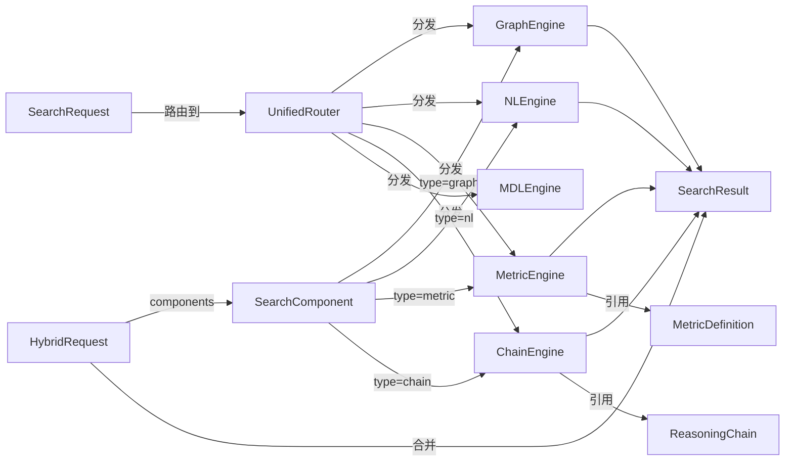

# Data Model: Semantic Retrieval Service Bus

**Feature**: 008-semantic-retrieval-bus
**Date**: 2026-07-30

> 本文定义语义检索服务总线的 6 个核心实体（Pydantic 模型）。所有实体均为**无状态请求/响应载体**，不持久化到数据库——检索服务是无状态编排层，状态由底层 QueryService/DeductionEngine/Neo4j 管理。

## 实体关系图

## 实体定义

### 1. SearchRequest（检索请求）

统一检索与分项检索的通用请求载体。

| 字段 | 类型 | 必填 | 说明 |
|------|------|------|------|
| `query` | `str` | 是 | 查询输入（自然语言或结构化表达式） |
| `mode` | `Literal["auto","chain","nl","mdl","graph","metric"]` | 否 | 检索模式，`auto` 为统一检索（默认） |
| `workspace_id` | `str` | 是 | 工作空间标识（从 JWT 提取，不可由客户端指定） |
| `filters` | `dict` | 否 | 过滤条件（object_type、relation_type、属性筛选） |
| `include_simulated` | `bool` | 否 | 是否包含推演态数据 `valid=false`，默认 `false`（FR-011） |
| `include_candidates` | `bool` | 否 | 是否包含候选态 `USL__Candidate`，默认 `false`（FR-011） |
| `time_window` | `TimeWindow` | 否 | 时间窗口过滤（FR-015） |
| `page` | `int` | 否 | 分页页码，默认 1 |
| `page_size` | `int` | 否 | 每页条数，默认 20，上限 100 |

**验证规则**:
- `page_size` MUST ≤ 100（防大数据量攻击）
- `workspace_id` MUST 来自 JWT，不接受请求体传入（FR-012 安全约束）

### 2. SearchResult（检索结果）

统一响应载体，所有检索端点返回此结构。

| 字段 | 类型 | 必填 | 说明 |
|------|------|------|------|
| `request_id` | `str` | 是 | 请求追踪 ID（用于审计关联） |
| `mode` | `str` | 是 | 实际执行的检索模式 |
| `entities` | `list[EntityHit]` | 否 | 命中的实体列表 |
| `relations` | `list[RelationHit]` | 否 | 命中的关系路径 |
| `reasoning` | `ReasoningChain` | 否 | 推理结论（chain/nl 模式） |
| `metrics` | `list[MetricValue]` | 否 | 指标值（metric 模式） |
| `total` | `int` | 是 | 总命中数（分页前） |
| `page` | `int` | 是 | 当前页码 |
| `duration_ms` | `int` | 是 | 执行耗时（毫秒，用于审计） |
| `warnings` | `list[str]` | 否 | 警告信息（循环检测、冲突、降级等） |

**子结构**:
- `EntityHit`: `{entity_id, object_type, properties, score}`
- `RelationHit`: `{source_id, target_id, relation_type, path[]}`
- `MetricValue`: `{metric_name, value, unit, dimensions}`

### 3. SearchComponent（检索组件）

混合检索的原子执行单元。

| 字段 | 类型 | 必填 | 说明 |
|------|------|------|------|
| `type` | `Literal["chain","nl","mdl","graph","metric"]` | 是 | 组件类型 |
| `params` | `dict` | 是 | 组件参数（同 SearchRequest 的对应字段子集） |
| `on_failure` | `Literal["skip","abort","degrade"]` | 否 | 失败策略，默认 `skip`（FR-008） |

**验证规则**:
- 混合检索组件数 MUST ≤ 10（超 5 个时返回性能警告，FR 边界场景）

### 4. ReasoningChain（推理链）

链式推理的执行路径，记录每步中间结果。

| 字段 | 类型 | 必填 | 说明 |
|------|------|------|------|
| `chain_id` | `str` | 是 | 推理链 ID |
| `steps` | `list[ChainStep]` | 是 | 步骤序列 |
| `conclusion` | `str` | 是 | 最终结论 |
| `confidence` | `float` | 是 | 置信度 0-1 |
| `cycle_detected` | `bool` | 是 | 是否检测到循环依赖（FR-014） |
| `cycle_path` | `list[str]` | 否 | 循环路径（当 cycle_detected=true） |
| `conflicts` | `list[RuleConflict]` | 否 | 规则冲突列表 |

**子结构**:
- `ChainStep`: `{step_id, rule_id, input, output, duration_ms}`
- `RuleConflict`: `{rule_a, rule_b, description}`

**状态转换**: `PENDING → RUNNING → COMPLETED | FAILED | ABORTED(cycle)`

### 5. MetricDefinition（指标定义）

指标查询的描述（Phase 1 仅支持自动派生，不持久化）。

| 字段 | 类型 | 必填 | 说明 |
|------|------|------|------|
| `metric_type` | `Literal["count","sum","avg","density","trend"]` | 是 | 聚合方式 |
| `target` | `Literal["object_type","relation_type","property"]` | 是 | 统计目标 |
| `target_filter` | `str` | 否 | 目标筛选（如 ObjectType 名称） |
| `granularity` | `Literal["day","week","month"]` | 否 | 时间聚合粒度（trend 必填，FR-015） |
| `group_by` | `str` | 否 | 分组字段 |

**Phase 1 支持的自动派生指标**:
- `count` + `object_type` → 各 ObjectType 实例数
- `density` + `relation_type` → 各 RelationType 连接密度
- `trend` + `object_type` + `granularity` → 新增实例时间趋势

### 6. MCPToolRegistration（MCP 工具注册）

语义检索能力向 MCP Server 的注册描述（Phase 3）。

| 字段 | 类型 | 必填 | 说明 |
|------|------|------|------|
| `tool_name` | `str` | 是 | 工具名（如 `ontology_query`） |
| `description` | `str` | 是 | 工具描述 |
| `input_schema` | `dict` | 是 | 输入 JSON Schema |
| `maps_to` | `str` | 是 | 映射的检索模式（auto/nl/graph/metric/chain） |
| `requires_workspace` | `bool` | 是 | 是否需要 workspace 上下文（默认 true） |

**Phase 3 注册的工具**:
- `ontology_query` → mode=auto（统一检索）
- `ontology_reason` → mode=chain（链式推理）
- `ontology_metric` → mode=metric（指标查询）

## 存储说明

**本特性不新建持久化表**。所有实体为无状态请求/响应模型：
- 检索请求不持久化（隐私 + 性能）
- 审计日志通过 `storage_audit` 写入现有审计表，仅记录 `{action, query_type, result_count, duration_ms, workspace_id}`，**不记录查询内容**（FR-013）
- 推理链结果由底层 `DeductionEngine` 存储于现有 `simulation_scenarios` 表

## 验证规则汇总

| 规则 | 实体 | 约束 |
|------|------|------|
| FR-011 | SearchRequest | `include_simulated`/`include_candidates` 默认 false |
| FR-012 | SearchRequest | `workspace_id` 强制来自 JWT |
| FR-013 | SearchResult | 审计仅记统计，不记内容 |
| FR-014 | ReasoningChain | `cycle_detected` 必填，循环时中止 |
| FR-015 | MetricDefinition | `trend` 类型 `granularity` 必填 |
| 边界 | SearchComponent | 组件数 ≤ 10，>5 时警告 |
| 边界 | SearchRequest | `page_size` ≤ 100 |
