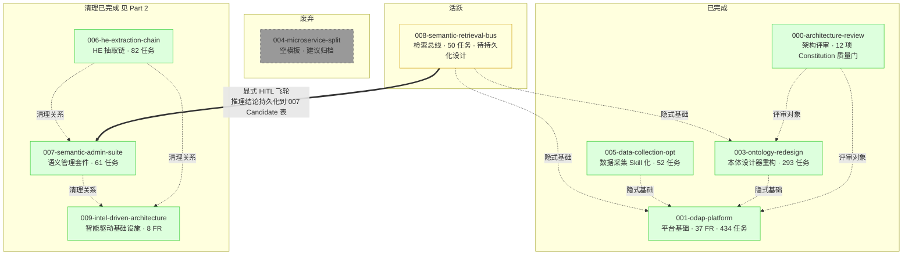

# Spec 梳理与版块清理记录（Spec Inventory & Refactoring Notes）

> 本文档含两部分：
> - **Part 1**（2026-08-08）：全局 Spec 梳理（9 个 spec 的进度 / 依赖 / 一致性 / 重叠）
> - **Part 2**（2026-08-07）：版块清理决策记录（006/007/009 三方清理）

---

## Part 1. 全局 Spec 梳理（2026-08-08）

**范围**: `specs/` 下全部 9 个 spec 目录（000-009，缺 002）
**维度**: 进度与状态 / 依赖与关系 / 一致性与冲突 / 重叠与边界
**方法**: 9 spec 关键文件读取 + 6 项已知 FAIL 现场验证 + 跨 spec 依赖 grep

### 1.1 进度与状态总览

| Spec | 状态 | 任务完成度 | 关键产物 | 备注 |
|------|------|:----------:|----------|------|
| **000-architecture-review** | ✅ 已完成 | 无独立 tasks（P0×7 + P1×6 + P3×1 全部修复） | 12 项 Constitution 质量门（G-1..G-12）作为 CI gate | 一次性评审记录，无 git feature branch；架构漂移评分 59→99 |
| **001-odap-platform** | ✅ 已完成 | 434/434（100%） | ODAP 平台基础（37 FR，~400+ REST 端点） | ⚠️ spec.md 状态字段仍为 `Draft`，与实际完成度不符 |
| **003-ontology-redesign** | ✅ 已完成 | 293/293（100%） | 本体设计器重构（手工/Schema 抽取/NL 提取三方式） | 设计器与"业务"子菜单共享同一份数据定义（FR-012） |
| **004-microservice-split** | ❌ 废弃 | 0/0（仅空 plan.md 模板） | 无 | ⚠️ speckit 生成的空模板，从未填写，建议归档至 `docs/11-archive/` |
| **005-data-collection-opt** | ✅ 已完成 | 52/52（100%） | 联网搜索 + 网页爬取 + 浏览器自动化注册为 Agent Skill | 容器：`graphiti-crawl4ai` + `graphiti-browser-use` |
| **006-he-extraction-chain** | ✅ 已完成 | 82/82（100%） | HE 抽取链（HEAdapter + TemplateEngine + ExtractService） | 版块清理后代码重构已落地（见 Part 2 + §1.3） |
| **007-semantic-admin-suite** | ✅ 已完成 | 61/61（4 Iter × 100%） | USL 管理 + OL 6 层流水线 + QG 22 子指标 + HITL 审批 | 6 子服务顶级域：usl_manager / ol_pipeline / candidate_store / quality_gate / approval_workflow / usl_writeback |
| **008-semantic-retrieval-bus** | 🟡 活跃（实现完成，待持久化扩展） | 50/50（100%） | 语义检索服务总线（7 REST + 7 MCP 工具，16 FR 验收 PASS） | ⚠️ `design-reasoning-persistence.md` 状态为 Design 待审查，是下一步工作入口 |
| **009-intel-driven-architecture** | ✅ 已完成 | 8 FR（4 Iter × 100%） | 智能驱动基础设施（save_audit_episode + feed_to_kb + Celery 三级队列 + MinIO + 多模态 + AG-UI） | 231 测试通过，零回归 |

**状态分布**: 已完成 7 / 活跃 1 / 废弃 1。

### 1.2 依赖与关系

#### 1.2.1 跨 Spec 依赖矩阵

> 仅记录显式 spec 引用（grep `specs/00X` / 文档内明确关联声明）。隐式依赖（如所有 spec 构建于 001 平台之上）单独标注。006/007/009 的清理互依赖见 Part 2。

| 依赖方 ↓ \ 被依赖方 → | 000 | 001 | 003 | 004 | 005 | 006 | 007 | 008 | 009 |
|:---|:---:|:---:|:---:|:---:|:---:|:---:|:---:|:---:|:---:|
| **000-architecture-review** | - | 评审对象 | 评审对象 | - | - | - | - | - | - |
| **001-odap-platform** | - | - | - | - | - | - | - | - | - |
| **003-ontology-redesign** | - | 隐式基础 | - | - | - | - | - | - | - |
| **004-microservice-split** | - | - | - | - | - | - | - | - | - |
| **005-data-collection-opt** | - | 隐式基础 | - | - | - | - | - | - | - |
| **006-he-extraction-chain** | - | 隐式基础 | - | - | - | - | 清理关系 | - | 清理关系 |
| **007-semantic-admin-suite** | - | 隐式基础 | - | - | - | 清理关系 | - | - | 清理关系 |
| **008-semantic-retrieval-bus** | - | 隐式基础 | 隐式基础 | - | - | - | **显式（HITL 飞轮）** | - | - |
| **009-intel-driven-architecture** | - | 隐式基础 | - | - | - | 清理关系 | 清理关系 | - | - |

#### 1.2.2 依赖关系图

#### 1.2.3 关键依赖说明

1. **000 → 001/003**: 000 是对 ODAP 平台代码库（主要由 001 + 003 构建）的实施后架构评审，产出的 12 项 Constitution 质量门被后续所有 spec 的 architecture-verify gate 隐式依赖。
2. **008 → 007（唯一显式跨 spec 依赖）**: 008 的 `design-reasoning-persistence.md` 显式引用 007 的 HITL 飞轮，`/chain` 和 `/mdl` 推理结论通过 opt-in 参数 `persist_candidates=True` 持久化到 007 管理的 `usl_schema_candidates` 表，进入 007 审批流。这是 6 个非清理 spec 中唯一的显式跨 spec 依赖，持久化设计实施时需与 007 对齐。
3. **001 作为基础平台**: 003/005/006/007/008/009 均隐式构建于 001 的平台基础设施之上（`get_current_user` / `storage_audit` / biz 模块结构 / Graphiti 集成），但无显式 spec 引用。
4. **004 无依赖**: 废弃空模板，与任何 spec 无引用关系。
5. **006/007/009 互依赖**: 见 Part 2（模板持久化 / 校验机制 / ExtractService 编排 / 审计体系的清理决策）。

### 1.3 一致性与冲突

#### 1.3.1 ✅ 6 项已知 FAIL 全部已修复（相比 2026-08-07 状态变化）

> 2026-08-07 验证清单标注 6 项 FAIL（83 通过 / 6 失败 / 7 待验证 / 1 N/A）。2026-08-08 现场验证确认全部修复，应更新为 **89 通过 / 0 失败 / 7 待验证 / 1 N/A**。

| FAIL 编号 | 类别 | 上次状态 (08-07) | 当前状态 (08-08) | 修复证据 |
|-----------|------|:----------------:|:----------------:|----------|
| **D3.3** | 文档级 · 高 | ❌ FAIL | ✅ 已修复 | [quality-gate-approval.md](file:///e:/DEMO/AI/ontology-graphiti/specs/007-semantic-admin-suite/contracts/quality-gate-approval.md) L83-120 `Quality22Submetrics` 类已定义 22 字段；L187/195 权重 `0.35/0.40/0.25`；L554 Section 4 标题改为"22 条 OPA Rego 规则"；L40-71 `SubmetricThreshold` 定义 22 常量 |
| **C2.3** | 文档级 · 中 | ❌ FAIL | ✅ 已修复 | [template-engine.md](file:///e:/DEMO/AI/ontology-graphiti/specs/006-he-extraction-chain/contracts/template-engine.md) L24 签名改为 `def __init__(self, he_adapter: HEAdapter, embedder=None):`，无 `storage` 参数 |
| **F1.3** | 代码级 | ❌ FAIL | ✅ 已修复 | [template_engine.py](file:///e:/DEMO/AI/ontology-graphiti/apps/api/odap/biz/data/hyper_extract/services/template_engine.py) L61-65 签名移除 `storage` 参数；L72-74 无 `self._storage` 赋值；文件头注释标注 ADR-074 settled template 移除 |
| **F1.4** | 代码级 | ❌ FAIL | ✅ 已修复 | [extract_service.py](file:///e:/DEMO/AI/ontology-graphiti/apps/api/odap/biz/data/hyper_extract/services/extract_service.py) 无 `import ValidationEngine`；`__init__` 无 `validation_engine` 参数；原 `_run_validation` 被 `_run_schema_learning_hook`（L926）取代 |
| **F1.5** | 代码级 | ❌ FAIL | ✅ 已修复 | [extract_service.py](file:///e:/DEMO/AI/ontology-graphiti/apps/api/odap/biz/data/hyper_extract/services/extract_service.py) L168-170 `schema_learning` 模式调用 `_run_schema_learning_hook`；L926-947 优先调用 007 `ConceptExtractor.run_l1_l2_hook()`，含 ImportError fallback |
| **F2.1** | 代码级 | ❌ FAIL | ✅ 已修复 | [quality_calculator.py](file:///e:/DEMO/AI/ontology-graphiti/apps/api/odap/biz/semantic_admin/quality_gate/services/quality_calculator.py) 文件存在，22 子指标完整实现（含 6 项 006 移交：`_eval_g1_fill_rate` / `_eval_g1_empty_rate` / `_eval_g1_orphan_ratio` / `_eval_g2_dangling_relations` / `_eval_g2_invalid_action_targets` / `_eval_g2_invalid_rule_references`） |
| **F2.2** | 代码级 | ❌ FAIL | ✅ 已修复 | [concept_extractor.py](file:///e:/DEMO/AI/ontology-graphiti/apps/api/odap/biz/semantic_admin/ol_pipeline/services/concept_extractor.py) 文件存在（在 `ol_pipeline/services/`，符合 007 plan.md I2T1 设计），`run_l1_l2_hook()` 在 L99 实现 |

#### 1.3.2 ⚠️ 残留一致性问题（建议后续清理）

| # | 问题 | 文件 / 位置 | 严重度 | 建议 |
|---|------|-------------|--------|------|
| 1 | **001 spec.md 状态字段过时** | [001-odap-platform/spec.md](file:///e:/DEMO/AI/ontology-graphiti/specs/001-odap-platform/spec.md) 顶部 `Status: Draft` | 低 | 更新为 `Status: Completed`（434/434 任务完成） |
| 2 | **001 契约断层** | [001-odap-platform/contracts/README.md](file:///e:/DEMO/AI/ontology-graphiti/specs/001-odap-platform/contracts/README.md) 索引 21 个契约文件，目录下仅物理存在 2 个（README + core-ontology-p4.md） | 中 | 补齐缺失契约文档，或在 README 中注明"其余契约散落于各模块 `api/routes.py`" |
| 3 | **008 spec/分支号不一致** | [008-semantic-retrieval-bus/spec.md](file:///e:/DEMO/AI/ontology-graphiti/specs/008-semantic-retrieval-bus/spec.md) 顶部声明 spec 目录号 008 对应 git 分支号 009 | 中 | 在 CONTEXT.md 或 spec.md 顶部加注释说明编号规则，避免混淆 |
| 4 | **extract_service.py docstring 残留** | [extract_service.py](file:///e:/DEMO/AI/ontology-graphiti/apps/api/odap/biz/data/hyper_extract/services/extract_service.py) L105 / L241 docstring 仍含 "Validate via 4-dimensional ValidationEngine" | 低 | 清理 stale 注释（非实际代码，不影响功能） |
| 5 | **004 废弃未归档** | [004-microservice-split/](file:///e:/DEMO/AI/ontology-graphiti/specs/004-microservice-split/) 仅含空 plan.md 模板 | 低 | 归档至 `docs/11-archive/` 或在目录加 README 标注 Obsolete |

#### 1.3.3 ⏳ 待验证项（依赖本次 FAIL 修复，现可推进）

| 编号 | 检查项 | 当前状态 | 推进条件 |
|------|--------|----------|----------|
| F2.3 | 007 各子服务操作审计委托 009 `audit_helper`（不直接调 `UnifiedAudit.log_action`） | ⏳ 待验证 | 代码检查（`audit_helper.py` 已存在，需确认 007 子服务调用点） |
| F2.4 | 007 `usl_outbox` 用途仅限 TBox 双写 | ⏳ 待验证 | 代码检查 |
| F2.5 | 007 instance 模式下 QG 也调用，结果写入 `ExtractionSession.validation_report` | ⏳ 待验证 | 代码检查 |
| F4.1 | 006 抽取完成 → `feed_to_kb` → 009 HE kb 写入（端到端） | ⏳ 待验证 | 集成测试（F1.3-F1.5 已修复，可推进） |
| F4.2 | 006 schema_learning 模式 → hook → 007 Candidate 双写（端到端） | ⏳ 待验证 | 集成测试（F1.5 + F2.2 已修复，可推进） |
| F4.3 | 007 审批通过 → usl_outbox TBox 双写 + 009 audit_helper 操作审计（端到端） | ⏳ 待验证 | 集成测试（F2.1 已修复，可推进） |
| F4.4 | 006 Channel B → 009 save_audit_episode 零 LLM 写入（端到端） | ⏳ 待验证 | 集成测试 + token_tracker 验证 |

### 1.4 重叠与边界

#### 1.4.1 已清理的重叠（006/007/009，详见 Part 2）

| 重叠领域 | 涉及 spec | 清理决策 |
|----------|-----------|----------|
| 模板持久化 | 006 vs 009 | 删除 006 应用层，统一委托 009 FR-003 `he feed` |
| 校验机制 | 006 vs 007 | 删除 006 `ValidationEngine`，4 维校验合并到 007 QG（16→22 子指标） |
| ExtractService 编排 | 006 vs 007 | 006 主导编排，007 通过 hook 调用 |
| 审计体系 | 006 vs 007 vs 009 | 统一委托 009 FR-006 分层审计，007 保留 `usl_outbox` 仅用于 TBox 双写 |

**代码层面验证**（2026-08-08）: 4 项清理决策全部已落地（见 §1.3.1 F1.3-F1.5 / F2.1-F2.2）。

#### 1.4.2 未清理的功能重叠（历史性，无需处理）

| 重叠领域 | 涉及 spec | 状态 | 说明 |
|----------|-----------|------|------|
| 本体管理 | 001 vs 003 | 历史性重叠，003 是更彻底重构版本 | 003 重构了 001 的本体设计能力，001 的本体管理 API 仍存在但被 003 覆盖；无需清理，003 为权威实现 |
| 数据采集 | 005 vs 009 | 职责分离，无重叠 | 005 负责 Agent Skill 化（搜索/爬取/浏览器），009 负责数据摄入管道（Celery 队列 + MinIO 持久化 + 多模态处理）；005 采集的产物通过 009 摄入管道进入图谱 |

#### 1.4.3 跨 Spec 协作边界（008 ↔ 007）

008 检索总线与 007 语义管理套件存在唯一的显式跨 spec 协作：

- **数据流**: 008 `/chain` 和 `/mdl` 推理结论 →（opt-in `persist_candidates=True`）→ 007 `usl_schema_candidates` 表 → 007 HITL 审批飞轮
- **设计状态**: 008 `design-reasoning-persistence.md` 仍为 Design 待审查，未实施
- **实施约束**: 持久化设计实施时需与 007 团队对齐 Candidate 表 schema 和审批状态机
- **零侵入原则**: `ReasoningPersistenceService` 独立新建，`MdlEngine` / `ChainEngine` 零改动保持纯计算

### 1.5 全局梳理结论

1. **整体进度健康**: 9 个 spec 中 7 个已完成、1 个活跃（008 待持久化扩展）、1 个废弃（004）。活跃的 008 实现层 50 任务全部完成、16 FR 验收 PASS，仅剩 `design-reasoning-persistence.md` 设计待审查落地。
2. **版块清理已闭环**: 006/007/009 的 4 大重叠区全部清理完成，文档级 + 代码级 6 项 FAIL 全部修复，跨 spec 引用闭环，下游零破坏。
3. **下一步工作入口**:
   - **优先**: 推进 7 项 ⏳ 待验证项（F2.3-F2.5 + F4.1-F4.4），现 6 项 FAIL 已修复，集成测试可启动
   - **次优**: 008 `design-reasoning-persistence.md` 设计审查 + 实施（与 007 对齐）
   - **低优**: 5 项残留一致性问题清理（§1.3.2）
4. **无新增重叠风险**: 当前 9 spec 职责边界清晰，004 废弃后无悬空规划，008 是唯一活跃分支且依赖关系明确。

---

## Part 2. 版块清理决策记录（Refactoring Notes · 2026-08-07）

**日期**: 2026-08-07
**范围**: 006-he-extraction-chain / 007-semantic-admin-suite / 009-intel-driven-architecture
**触发**: 用户要求分析建本体中各版块的具体工作是否有重叠，清理掉功能重复的版块并重新设计

> **2026-08-08 更新**: Part 2 记录的 4 项清理决策已全部落地，6 项 FAIL 已修复（见 Part 1 §1.3.1）。

---

## 1. 问题诊断：四大重叠区

经分析 006/007/009 三个 spec，发现以下四个领域存在功能重叠：

| # | 重叠领域 | 涉及 spec | 冲突描述 |
|---|---------|----------|---------|
| 1 | **模板持久化** | 006 vs 009 | 006 在应用层实现 `settle_template` / `get_settled_template` + `SqliteTemplateStorage` + `he_templates` 表；009 的 HE 原生 `he feed` 已支持 kb 持久化与复用 → **双重持久化源** |
| 2 | **校验机制** | 006 vs 007 | 006 的 `ValidationEngine`（4 维校验：Schema 一致性 / 完整性 / 置信度 / 引用一致性）与 007 的 3 关质量闸（QG-1 置信度去重 / QG-2 结构一致性 / QG-3 LLM 语义）在置信度和结构一致性上高度重叠；`needs_review` 列表双方重复定义 |
| 3 | **ExtractService 编排** | 006 vs 007 | 006 和 007 都试图在 ExtractService 中实现 `mode=schema_learning` 参数，三方（含 009）争抢 ExtractService 编排权 |
| 4 | **审计体系** | 006 vs 007 vs 009 | 006 Channel B 走 Graphiti `add_episode`（3-9 次 LLM）；007 各子服务直接调 `UnifiedAudit.log_action`；009 定义了分层审计但 006/007 未委托 → **审计碎片化** |

---

## 2. 清理决策

### 2.1 模板持久化：删除应用层，委托 009 HE kb

**决策**：删除 006 应用层模板持久化，统一由 009 FR-003 `he feed` 增量演化承担。

**理由**：HE 原生已支持 kb 持久化与复用（`he feed` 命令），应用层重复实现造成双重持久化源，维护成本高且易不一致。

| 删除项 | 原 006 位置 | 替代方案 |
|--------|-----------|---------|
| `settle_template()` | 006 FR-017 | 009 FR-003 `he feed` 自动持久化 |
| `get_settled_template()` | 006 FR-018 | 009 HE kb 内部自动复用 |
| `SqliteTemplateStorage` | 006 plan/storage/ | 删除，不再新建 |
| `he_templates` 表应用层写入 | 006 data-model.md | HE kb 原生管理，应用层不写 |
| 沉淀模板轻量验证 | 006 FR-019 | HE kb 自动管理知识演化 |

**新增**：006 HEAdapter 提供 `feed_to_kb(kb_path, text, result)` 方法（FR-024），委托 009 FR-003。

### 2.2 校验机制：合并到 007 QualityGateService

**决策**：删除 006 `ValidationEngine`，4 维校验合并到 007 的 3 关质量闸。

**理由**：QG-1（置信度+去重）与 006 置信度校验重叠；QG-2（结构一致性）与 006 Schema 一致性校验重叠。合并后避免两套校验逻辑并行维护，`needs_review` 列表统一由 QG 产出。

| 006 校验维度 | 007 承接位置 | 子指标编号 |
|-------------|-------------|----------|
| 置信度评分 | QG-1（与 Jaccard 去重合并） | G1.7（原有） |
| 完整性校验 | QG-1 扩展 | G1.8 fill_rate / G1.9 empty_rate / G1.10 orphan_count |
| Schema 一致性 | QG-2（结构一致性） | G2.1-G2.3（原有） |
| 引用一致性 | QG-2 扩展 | G2.5 dangling_relations / G2.6 invalid_action_targets / G2.7 invalid_rule_references |
| LLM 语义评审 | QG-3（007 原有，006 无） | G2.4（原有） |
| needs_review 列表 | 007 审批流统一产出 | — |

**结果**：质量闸从 3 关 × 16 子指标扩展为 **3 关 × 22 子指标**（G1: 7→10, G2: 4→7, G3: 5 不变）。

**instance 模式**：QG-1/QG-2 在 instance 模式下也调用，结果写入 `ExtractionSession.validation_report`。

### 2.3 ExtractService 编排：006 主导，007 hook 调用

**决策**：ExtractService 编排权统一归 006（FR-037），007 通过 hook 机制调用。

**理由**：避免三方争抢编排权导致接口冲突。006 负责完整的抽取编排链路（模板评估→多模板抽取→LLM 补充→映射→feed_to_kb→写入），007 仅在 `mode=schema_learning` 时通过后置 hook 叠加 L1-L2 概念抽取。

| 职责 | 归属 | 接口 |
|------|------|------|
| ExtractService 编排 | 006 FR-037 | `ExtractService.extract(text, ontology_id, mode=...)` |
| schema_learning hook | 007 提供，006 调用 | `ConceptExtractor.run_l1_l2_hook(raw_extraction_result, ontology_id, domain_id, config)` |
| hook 异常处理 | 006 负责 | catch + 日志 warning，不阻断主流程 |

**原 007 US4** 从"直接实现 ExtractService mode 参数"改为"提供 hook 接口供 006 调用"。

### 2.4 审计体系：统一到 009 分层审计

**决策**：操作审计统一委托 009 FR-006 分层审计，007 保留 `usl_outbox` 仅用于 TBox 双写。

**理由**：006 Channel B 走 Graphiti `add_episode`（3-9 次 LLM 调用）成本过高；007 各子服务直接调 `UnifiedAudit.log_action` 绕过 009 分层体系。统一后消除审计碎片化。

| 审计类型 | 009 承接 | 消费方 |
|---------|---------|--------|
| #1 数据采集 + #2 抽取过程 + #4 推理过程 | Graphiti 零 LLM（`save_audit_episode`） | 006 Channel B |
| #3 确认过程 + #5 查询过程 | audit_helper（SQLite） | 006/007 操作审计 |
| TBox 双写同步 | 007 `usl_outbox`（保留） | 007 usl_writeback |

**Channel B 变更**：content 从"HE 结果文本化"改为"审计事件 JSON"，`EpisodicNode.save(driver)` 直接写入，零 LLM 调用。

---

## 3. 职责分配矩阵（清理后）

| 职责 | 006 | 007 | 009 |
|------|:---:|:---:|:---:|
| HE 包安装与 API 对齐 | ✅ | | |
| 统一 HEAdapter（parse/merge/trial_extract） | ✅ | | |
| HEAdapter.feed_to_kb | 调用方 | | ✅ 实现 |
| TemplateEngine（试抽评分+多模板选择+自定义生成） | ✅ | | |
| 模板持久化与复用 | ❌ 已删 | | ✅ he feed |
| ExtractService 编排（含 mode=schema_learning hook） | ✅ | | |
| L1-L2 概念抽取 hook | 调用方 | ✅ 实现 | |
| Candidate 双写（SQLite + Neo4j） | | ✅ | |
| 质量闸 QG-1/QG-2/QG-3（22 子指标） | | ✅ | |
| 4 维校验（ValidationEngine） | ❌ 已删 | ✅ 合并到 QG | |
| 2 级审批 + OPA 策略 | | ✅ | |
| HITL 写回 USL + TBox | | ✅ | |
| TBox 双写同步（usl_outbox） | | ✅ | |
| 操作审计（audit_helper SQLite） | | 委托 | ✅ |
| Graphiti 零 LLM 审计（save_audit_episode） | 委托 | | ✅ |
| 统一 AuditEvent schema | | 委托 | ✅ |
| 数据摄入纯采集化 | | | ✅ |
| Celery 三级优先级队列 | | | ✅ |
| MinIO 原始数据持久化 | | | ✅ |
| 多模态处理 | | | ✅ |
| AG-UI 协议适配 | | | ✅ |

---

## 4. 文件变更清单

### 006-he-extraction-chain

| 文件 | 变更类型 | 说明 |
|------|---------|------|
| `spec.md` | 修改 | 删除 FR-017/018/019（模板沉淀）、FR-024~029（ValidationEngine）；US3 改为用后即弃+feed_to_kb；US4 标记移交 007；新增 FR-024 feed_to_kb |
| `plan.md` | 修改 | 删除 ValidationEngine/SqliteTemplateStorage 任务；项目结构移除 storage/ 和 validation_engine.py；TDD 移除对应测试项 |
| `data-model.md` | 修改 | 顶部添加废弃说明（HETemplate/ValidationReport/settle_template 标记移交/删除） |
| `contracts/validation-engine.md` | 修改 | 顶部添加⚠️已废弃声明，映射到 007 QG 位置 |
| `contracts/template-engine.md` | 修改 | 顶部添加清理说明（settle/get_settled/SqliteTemplateStorage 已删除） |
| `contracts/he-adapter.md` | 修改 | 顶部添加 feed_to_kb 方法说明（FR-024 委托 009） |
| `quickstart.md` | 修改 | §3 校验报告改为 007 QG 委托；§4 模板沉淀替换为 feed_to_kb 验证；§5 测试命令移除已删测试文件 |
| `tasks.md` | 修改 | 顶部添加⚠️版块清理说明（已废弃任务表格 + 新增任务 T066/T067） |

### 007-semantic-admin-suite

| 文件 | 变更类型 | 说明 |
|------|---------|------|
| `spec.md` | 修改 | 顶部添加版块清理说明（移交/移出表格）；US4 改为 hook 调用 006；QG-1 扩展完整性；QG-2 扩展引用一致性；design 引用表 16→22 |
| `plan.md` | 修改 | 顶部添加版块清理说明；Summary/Constitution/TDD/项目结构中 16→22 子指标；新增 ConceptExtractor hook TDD 项；concept_extractor.py 加入 ol_pipeline |
| `data-model.md` | 修改 | §4 质量闸公式 G1×7→G1×10、G2×4→G2×7；新增 G1.8-G1.10 + G2.5-G2.7 子指标行 |
| `contracts/quality-gate-approval.md` | 修改 | 顶部添加版块清理说明；16 子指标→22 子指标；Quality16Submetrics→Quality22Submetrics |
| `contracts/api-contracts.md` | 修改 | Quality16Submetrics→Quality22Submetrics；子指标列表扩展为 22 项 |
| `tasks.md` | 修改 | 顶部添加⚠️版块清理说明（16→22 增量任务说明） |
| `checklists/requirements.md` | 修改 | 顶部添加⚠️版块清理说明（FR-030/031/NFR-004 需追加 22 子指标验收） |

### 009-intel-driven-architecture

| 文件 | 变更类型 | 说明 |
|------|---------|------|
| `spec.md` | 修改 | 顶部添加版块清理说明（从 006/007 移交职责表格 + 009 提供能力表格）；FR-003 明确为 HE kb 唯一规范实现；FR-006 明确 007 审计委托 |
| `plan.md` | 修改 | 顶部添加版块清理说明（从 006/007 移交职责表格 + 已实现状态） |

### specs/

| 文件 | 变更类型 | 说明 |
|------|---------|------|
| `REFACTORING-NOTES.md` | **新建** | 本文件——版块清理决策完整记录 |
| `REFACTORING-VERIFICATION-CHECKLIST.md` | **新建** | 验证清单（7 大类 97 项：A-F 类 85 项清理范围内 + G 类 12 项下游影响验证。已执行：83 通过 / 6 失败 / 7 待验证 / 1 N/A） |
| `REFACTORING-SCAN-REPORT.md` | **新建** | 全 Spec 扫描报告（67 个 .md 文件，331 命中，下游 15 命中经核查全部合法） |

---

## 5. 验证清单

> 完整验证清单见 [REFACTORING-VERIFICATION-CHECKLIST.md](./REFACTORING-VERIFICATION-CHECKLIST.md)（7 大类 97 项，已全部执行）。

- [x] 006 spec.md 不再包含 `settle_template` / `get_settled_template` / `ValidationEngine` 的功能需求（仅保留删除标记）
- [x] 006 plan.md 项目结构中无 `storage/` 目录和 `validation_engine.py`
- [x] 006 contracts/validation-engine.md 顶部有⚠️已废弃声明
- [x] 007 spec.md US4 描述为 hook 调用而非直接实现 mode 参数
- [x] 007 plan.md 所有子指标计数为 22（非 16），G1×10/G2×7/G3×5
- [x] 007 data-model.md §4 包含 G1.8-G1.10 和 G2.5-G2.7 子指标行
- [ ] 007 contracts/quality-gate-approval.md 所有"子指标"计数为 22 ❌ **FAIL**（顶部说明提及 22，但正文 `Quality22Submetrics` 类仍只定义 16 字段 + 权重仍为 0.3/0.4/0.3，见待修正项 #1）
- [x] 009 spec.md FR-003 标注为"唯一规范实现"
- [x] 009 spec.md FR-006 包含 007 审计委托说明
- [x] 三个 spec 的版块清理说明相互交叉引用一致
